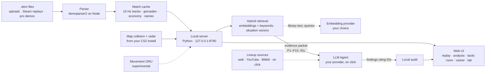

<div align="center">

# RoundCrafter

### Every round, on the record.

**Demo analysis for Counter-Strike 2. An AI analyst reads each round, checks the key moments<br>and explains what happened, and every claim links back to a clip you can replay.**

**[Website](https://ethany14.github.io/Cs2-Roundcrafter/)** · [English](#english) · [中文](#中文)


| 4 | 100% | 0 | 0 |
|:---:|:---:|:---:|:---:|
| Agent analysis modes | Claims tied to evidence IDs | Player names sent to the model | Model calls without a click |

</div>

---

<a id="english"></a>

RoundCrafter turns your CS2 `.dem` files into a lab you can study. The AI analyst is the center of it. Around it sit a broadcast-style replay, multi-round heatmaps, a tactic room, your Steam career and a utility lab. Everything runs on your own machine. Only three things reach the network, and only after you set them up or start them: the anonymised evidence you send to your model, library text and queries sent to your embedding provider, and lineup research reading public web pages.

## Agent analysis: an analyst that shows its evidence

The Agent never watches the demo raw. The server first builds an **evidence packet** from the parsed match (positions, utility, kills, economy), with an ID on every item. The Agent reads it with tools, checks the windows that matter, and submits findings that must cite those IDs. A local audit then removes anything the data does not support.

**One round read, step by step:**

1. `read_round_evidence()`: facts and testable hypotheses for the round.
2. `read_action_window(start, end)`: player states and events in a window of up to 30 s.
3. `submit_findings(…)`: rejected unless every evidence ID exists in the packet.
4. **Local audit**: claims the data does not support are removed, e.g. utility that was not near the entry it supposedly set up.

Each run is capped: a round read gets up to 5 calls, a 50k input-token limit and 300 s.

**What a finding looks like** (illustrative example, Dust2 round 6):

> **T side took mid before splitting to B**
>
> | | |
> |---|---|
> | **Facts** | `E4` P2 and P5 reach Top of Mid by 0:22 · `E7` Smoke detonates at CT mid at 0:24 · `E9` P1 enters B site at 0:41 |
> | **Inference** | The mid smoke cut the CT rotation path, so B saw one defender at the moment of entry. |
> | **Uncertainty** | Voice comms are not in the demo, so the plan is inferred from movement. |
> | **Try this** | As CT, keep one player able to reach B through tunnels before the mid smoke lands. |
>
> ▶ Replay 0:18 – 0:42

### Four modes

| Mode | What it does | Budget |
|---|---|---|
| **Round read** | Both sides' actions in one round, checked window by window. | ≤ 5 calls per round |
| **Whole match** | Runs the round read across a match in parallel, under one total budget you set. | 1–200 calls · 2 per round · 30 min |
| **Patterns** | Finds habits repeated across the rounds you filtered, optionally against a reference group. | ≤ 2 calls · up to 4 findings |
| **Pro comparison** | Retrieves a structurally similar pro round on your machine, then explains the differences worth learning and when they apply. | ≤ 2 calls · findings + limits |

### Guardrails

- **Facts apart from guesses.** Each finding separates facts, inference, uncertainty and a recommendation.
- **Anonymised players.** The model sees P1–P10. Names and SteamIDs stay on your machine, and a test enforces it.
- **Your model, your language.** Pick Claude, GPT, Gemini, DeepSeek, Qwen, Kimi, GLM, Grok, Mistral, OpenRouter, Groq or a local Ollama model, and paste your key in the app. Answers follow the 中文 / English switch.

### Retrieval: vector RAG grounded in real sources

The Agent does not answer from memory. Before it explains anything, RoundCrafter retrieves comparable material from its own libraries, and the Agent's findings have to point back to what was retrieved.

Retrieval is **hybrid vector search**:

- **Text libraries** are embedded by the provider you choose under **Model → Embeddings** (OpenAI, Voyage AI, Gemini, Qwen, Zhipu, Mistral, Ollama or any OpenAI-compatible endpoint). Each query is embedded too, and results are ranked by cosine similarity blended with the keyword score. A Chinese query finds English sources and the other way round.
- **Pro rounds and the pro casebook** become numeric **situation vectors** (positions, timing, economy, routes, players alive), computed on your machine, and are searched by nearest neighbour.
- **Hard filters run first** (map, side, site, phase, bomb state, grenade type), so similarity never overrides the game state.
- **Vectors are cached** in `data/vectors/index.sqlite` by model and text hash, so each text is embedded once per model. Without an embedding model, or if the provider fails, retrieval falls back to keyword ranking and says so in its result.

| Library | What it holds | How it is matched | Used by |
|---|---|---|---|
| **Pro rounds** | Rounds from the pro demos you import. A demo counts as verified only when its file fingerprint matches a curated source list; otherwise it is marked "declared, unverified". | Hard filters on map, side, target site, phase, players alive and route overlap, then nearest neighbours over situation vectors (hashed approach zones, alive counts, buy, timing, utility, entry gap). No model call. | Pro comparison: every finding must cite evidence from both rounds. |
| **Pro casebook** | The 2 s before each death in pro matches, split into reference and test matches. | Exact match on players alive and bomb state, then nearest neighbours over pre-event situation vectors (position, time, equipment, teammate spacing). Outcomes never affect rank. | `retrieve_pro_cases` in case review; the Agent must read a reference before it can finish. |
| **Tactic cards** | Tactic library entries (map, side, economy, video source). | Map/side/economy filter, then embedding similarity blended with BM25-style keywords. Missing prerequisites stay "unknown", never assumed. | `retrieve_tactic_cards`; the model may only pick up to 3 card IDs, never free text. |
| **Reviewed notes** | Utility and tactic notes with an https source and an explicit review flag. | Reviewed rows only: embedding similarity blended with full-text rank; a vector-only hit must clear a similarity floor. | `search_tactical_knowledge`: an empty result means no verified knowledge, and the model is told not to invent it. |
| **Your case library** | Claims from your finished Agent reviews whose evidence IDs still resolve. | Embedding similarity blended with keyword and Chinese-bigram overlap. | Search past findings from the review page. |
| **Lineup cards and research** | Local lineup and learning cards; web pages and YouTube / Bilibili captions only when you start research. | Hard filters on grenade type and destination, then hybrid ranking. Research accepts a field only if it is quoted verbatim from a page that was actually read. | `start_lineup_research` in the tactics assistant. |

Retrieved is not the same as verified: tactic cards are learning references, lineups stay "unverified in game", and Agent claims stay labelled as model inference.

## The workspace around the Agent

Most demo viewers only play a match back. These modules let you see what the Agent is talking about, and study it yourself.

### 01 · Round review: a 2D replay with the real utility
- 16 Hz interpolated playback with real player names, HP and armor bars, the weapon in hand and full loadout icons.
- Real grenade trajectories with smoke, molotov, flash and HE effects, shot tracers and a kill feed.
- Live score, freeze-time economy and event ticks on the timeline. Switch floors on two-level maps such as Nuke.

### 02 · Multi-round analysis: patterns, not single rounds


- Filter by map, side, economy, opening and players, then overlay every matching round.
- Dwell, reach, scoped, kill and death heatmaps, with the sample size shown.
- Grenade clustering by type, side and floor. Compare your matches with pro reference demos.
- Ask the Agent to explain the selection (Patterns mode), and every claim links back to a playable clip.

### 03 · Tactic room: plan it, then play it


- A personal library of tactics with tags, folders and notes.
- Multi-stage board with players, routes, smokes, flashes, molotovs, HE, arrows and text, on both floors.
- **▶ Play** animates the stages in the same engine as real demos, or start a plan from any moment of a real match.

### 04 · My career: sign in once, new matches import themselves
- Steam sign-in (OpenID). New share codes are detected and demos in your replays folder are imported automatically.
- Rating 1.0 and an approximate Rating 2.0, ADR capped at the victim's remaining HP, KAST with 5-second trades, opening duels and HS%.
- Jump from any match straight into its replay.

### 05 · Utility lab: find a lineup with physics


- Click where you stand and where the grenade should land. The lab searches standing, jump, W-jump, crouch-jump and run-jump throws against the map's real collision geometry.
- It returns aim angles, flight time, bounces and a `setpos/setang` command to practise in game.

### Bilingual
Every screen switches between **中文 / English** with one click.

> **Experimental · Movement prediction.** A small side project for fun: pick a player in the replay and a local GRU guesses where they will be 0.5–2 s later, drawn next to the real track. It is a toy, not a coaching tool. Validation notes: [`outputs/movement/web/`](outputs/movement/web/移动预测网页接入-验证报告.md).

## How it works

Each demo is parsed once into a per-match cache. Everything after that reads from the cache, on your machine.



## Privacy and trust

- **Local by default.** The server binds to `127.0.0.1`, checks Host and Origin, and requires a session token for every write.
- **Your keys stay yours.** You enter the Steam Web API key and the model API key in the app. They are stored in `data/account/` on your machine and never sent back by the API.
- **No silent model calls.** The LLM runs only when you click, and each run has a call budget.
- **No silent web access.** Lineup research reads public pages and videos only when you start it, with fixed search and read budgets.
- **You choose what gets embedded.** Library text and search queries go to the embedding provider you set up; situation vectors for pro rounds and the casebook are computed locally and never sent.
- **Honest outputs.** Model results are labelled, inferences are kept apart from observed facts, and the validation reports in `outputs/` include the failures.

## Quick start

| Requirement | |
|---|---|
| OS | Windows |
| Python | ≥ 3.12 |
| Node | ≥ 22 |
| CS2 install | radar images and icons |
| Model API key | optional, set in the app |
| Embedding API key | optional, for vector retrieval |

```powershell
python -m venv .venv
./.venv/Scripts/python.exe -m pip install -e ".[test]"
npm install --prefix outputs/cs2-coach-prototype   # demo parser
./start-tactics.ps1
```

Then open **http://127.0.0.1:8790**, upload a `.dem` or link Steam, and open the match.

- **Turn on the Agent:** click **Model** in the top bar, pick a provider, paste your API key and press **Test connection**. `.env` still works as a fallback (see `.env.example`).
- **Turn on vector retrieval:** in the same dialog open **Embeddings**, pick an embedding provider (Claude users: Voyage AI is Anthropic's recommended partner) and press **Rebuild index**. Without it, retrieval uses keyword ranking.
- **Weapon icons** are imported from your CS2 install with `experiments/import-icons.ps1`.
- **Movement prediction (optional):** `pip install -r requirements-training.txt` for PyTorch, plus the trained checkpoints in `outputs/movement/comparison/`. These are local artifacts, not stored in git.

## Project layout

```
backend/cs2_agent/   server, demo processing, agents, retrieval, model settings, stats, Steam hub, tactic room
backend/eregion/     AgentLoop runtime
web/                 UI: replay engine, analysis workbench, tactic board, lab
experiments/         demo extraction scripts and the movement-model training code
tests/               pytest suite
outputs/**/*.md      validation reports
docs/                website, images and the research log
```

```powershell
$env:PYTHONPATH='backend'; ./.venv/Scripts/python.exe -m pytest -q
```

---

<a id="中文"></a>

## 中文

<div align="center">

### 每一回合，都有据可查。

**Counter-Strike 2 demo 分析工具。AI 分析师逐回合读取证据、核对关键时刻、解释发生了什么，<br>每条结论都能跳回可重播的片段。**

**[产品网站](https://ethany14.github.io/Cs2-Roundcrafter/)**


| 4 | 100% | 0 | 0 |
|:---:|:---:|:---:|:---:|
| 种 Agent 分析模式 | 结论绑定证据编号 | 个选手名发送给模型 | 次未经点击的模型调用 |

</div>

RoundCrafter 把你的 CS2 `.dem` 变成可以研究的实验室。核心是 AI 分析师，配套有转播级回放、多回合热力图、战术室、Steam 生涯和道具实验室。全部计算都在你自己的电脑上完成。只有三件事会联网，而且都要你先设置或主动启动：发送给模型的匿名证据、发送给向量服务商的资料库文本和查询，以及投掷点研究读取公开网页。

### Agent 分析：会出示证据的 AI 分析师

Agent 不直接“看” demo。服务端先从解析结果生成**证据包**：站位、道具、击杀、经济，每条都有编号。Agent 用工具读取证据、核对关键时间窗，提交的每条发现都必须引用这些编号；随后本地审核会删掉数据不支持的结论。

**一次单回合解读的流程：**

1. `read_round_evidence()`：读取本回合的事实与可验证假设。
2. `read_action_window(start, end)`：核对最长 30 秒时间窗内的玩家状态与事件。
3. `submit_findings(…)`：只要有一个证据编号不在证据包里，就会被拒绝。
4. **本地审核**：删除数据不支持的结论，例如与进点没有空间关联的道具。

每次运行都有上限：单回合解读最多 5 次调用、输入上限 5 万 token、限时 300 秒。

**一条发现长这样**（示例，Dust2 第 6 回合）：

> **T 方先控中路，再分兵打 B**
>
> | | |
> |---|---|
> | **事实** | `E4` P2、P5 在 0:22 前到达中路上端 · `E7` 0:24 烟雾在 CT 中路生效 · `E9` P1 在 0:41 进入 B 包点 |
> | **推断** | 中路烟切断了 CT 回防路线，因此进点时 B 区只有一名防守者。 |
> | **不确定性** | demo 不含语音，战术意图是根据走位推断的。 |
> | **建议** | CT 方应在中路烟落下前，保留一名可以从 B 洞回防的队员。 |
>
> ▶ 重播 0:18 – 0:42

#### 四种模式

| 模式 | 做什么 | 预算 |
|---|---|---|
| **单回合解读** | 逐个时间窗核对，解读一个回合里双方的行动。 | 每回合 ≤ 5 次调用 |
| **整场复盘** | 在整场比赛上并行运行单回合解读，使用你设定的总预算。 | 1–200 次 · 每回合 2 次 · 30 分钟 |
| **多回合规律** | 在你筛选出的回合中找重复习惯，可与参考组对比。 | ≤ 2 次调用 · 最多 4 条发现 |
| **职业对照** | 在本地检索结构相似的职业回合，解释值得学习的区别及适用条件。 | ≤ 2 次调用 · 发现 + 局限 |

#### 安全约束

- **事实与推断分开：** 每条发现分为事实、推断、不确定性和建议。
- **选手匿名：** 模型只看到 P1–P10，选手名和 SteamID 留在本机，并有测试保证。
- **自选模型与语言：** 可选 Claude、GPT、Gemini、DeepSeek、通义千问、Kimi、GLM、Grok、Mistral、OpenRouter、Groq 或本地 Ollama 模型，在应用内粘贴密钥即可；回答跟随中 / 英切换。

#### 检索：基于真实资料的向量 RAG

Agent 不凭记忆回答。解读之前，RoundCrafter 会先从自己的资料库检索可比的材料，Agent 的结论必须指回检索到的内容。

检索采用**混合向量搜索**：

- **文本资料库**由你在**模型 → 向量嵌入**中选择的服务商生成向量（OpenAI、Voyage AI、Gemini、通义千问、智谱、Mistral、Ollama，或任何兼容 OpenAI 的接口）。查询也会转成向量，按余弦相似度与关键词得分混合排序。中文查询可以找到英文资料，反之亦然。
- **职业回合与职业案例库**转成数值**情境向量**（站位、时间、经济、路线、存活人数），在本机计算，按最近邻检索。
- **先执行硬过滤**（地图、阵营、包点、阶段、下包状态、道具类型），相似度永远不会越过对局状态。
- **向量本地缓存**在 `data/vectors/index.sqlite`，按模型和文本哈希存储，同一模型下每段文本只生成一次。未配置向量模型或服务商出错时，检索退回关键词排序，并在结果中注明。

| 资料库 | 内容 | 匹配方式 | 用在哪里 |
|---|---|---|---|
| **职业回合** | 你导入的职业比赛 demo 中的回合。只有文件指纹与人工整理的来源列表一致才算已核验，否则标为“上传者声明，未核验”。 | 先按地图、阵营、目标包点、阶段、存活人数和路线重叠硬过滤，再在情境向量上找最近邻（哈希后的进攻区域、存活人数、经济、时间、道具、进点间隔）。不调用模型。 | 职业对照：每条发现都必须同时引用两个回合的证据。 |
| **职业案例库** | 职业比赛中每次死亡前 2 秒的情境，按比赛分为参考集和测试集。 | 存活人数和下包状态完全一致，再在事件前的情境向量（站位、时间、装备、队友距离）上找最近邻。结果从不影响排序。 | 案例复盘中的 `retrieve_pro_cases`；Agent 必须先读过参考案例才能结束。 |
| **战术卡片** | 战术库条目（地图、阵营、经济、视频来源）。 | 先按地图、阵营、经济过滤，再把向量相似度与 BM25 式关键词得分混合。缺失的前提保持“未知”，从不默认满足。 | `retrieve_tactic_cards`；模型最多只能选 3 个卡片编号，不能写自由文本。 |
| **已审核笔记** | 带 https 来源且明确标记为已审核的道具与战术笔记。 | 只检索已审核条目：向量相似度与全文检索排名混合；只靠向量命中的条目必须超过相似度下限。 | `search_tactical_knowledge`：结果为空即表示没有经核实的知识，并明确要求模型不要编造。 |
| **你的案例库** | 已完成的 Agent 复盘中、证据编号仍可对应的结论。 | 向量相似度与关键词、中文二元组重叠混合。 | 在复盘页搜索过往发现。 |
| **投掷点卡片与研究** | 本地投掷点和学习卡片；只有你启动研究后才读取网页和 YouTube / B 站字幕。 | 先按道具类型和落点硬过滤，再混合排序。研究中字段必须逐字引自真正读过的页面才会被采纳。 | 战术助手中的 `start_lineup_research`。 |

检索到不等于已验证：战术卡片只是学习参考，投掷点保持“未经游戏内验证”，Agent 的结论始终标注为模型推断。

### 围绕 Agent 的工作台

大多数 demo 播放器只会“放一遍”。这些模块让你看清 Agent 说的是什么，也方便自己研究。

#### 01 · 单回合复盘：带真实道具的 2D 回放
- 16 Hz 插值回放，真实选手名、血量护甲、手持武器和完整装备图标。
- 真实道具轨迹，烟、火、闪、雷效果，开枪线和击杀信息。
- 实时比分、冻结期经济、时间轴事件标记；Nuke 等多层地图可切换楼层。

#### 02 · 多回合分析：看规律，不只看单回合


- 按地图、阵营、经济、开局和玩家筛选，叠加所有符合条件的回合。
- 停留、可达、开镜、击杀、死亡热力图，并标明样本量。
- 按类型、阵营、楼层聚类道具落点；把你的比赛与职业 demo 对照。
- 让 Agent 解读当前筛选（多回合规律模式），每条结论都能跳回可播放的片段。

#### 03 · 战术室：先规划，再演示


- 个人战术库，支持标签、文件夹和备注。
- 多阶段战术板：队员、路线、烟闪火雷、箭头和文字，支持上下层。
- 点击 **▶ 演示**，用真实 demo 的回放引擎播放方案；也可以从比赛的任意时刻开始规划。

#### 04 · 我的生涯：登录一次，新比赛自动导入
- Steam 登录（OpenID）；自动识别新的分享码，并导入本地录像目录中的 demo。
- Rating 1.0 与近似 Rating 2.0；ADR 按受害者剩余血量封顶；KAST 计入 5 秒内补枪；首杀对决与爆头率。
- 从任意比赛一键跳转到回放。

#### 05 · 道具实验室：用物理找投掷点


- 点选站位和落点，基于地图真实碰撞几何，搜索站投、跳投、W 跳投、蹲跳投和助跑投。
- 给出瞄准角度、飞行时间、反弹次数，以及可在游戏里练习的 `setpos/setang` 指令。

#### 双语
所有界面一键切换 **中文 / English**。

> **实验功能 · 移动预测。** 一个好玩的小实验：在回放中选一名玩家，本地 GRU 猜他 0.5–2 秒后的位置，并和真实轨迹画在一起。仅供娱乐，不作为训练建议。验证记录见 [`outputs/movement/web/`](outputs/movement/web/移动预测网页接入-验证报告.md)。

### 工作原理

每个 demo 只解析一次，生成单场缓存，之后的功能都从缓存读取，全部在你的电脑上：demo 文件 → 解析 → 单场缓存 → 本地服务 → 网页界面。点击分析后，本地服务先用混合向量检索找出可比材料，再把匿名证据包（P1–P10、证据编号）发给你选择的模型，返回的发现经本地审核后显示在界面上。流程图见英文部分的 [How it works](#how-it-works)。

### 隐私与可信度

- **默认本地：** 服务只监听 `127.0.0.1`，校验 Host / Origin，所有写操作都需要会话令牌。
- **密钥留在本机：** Steam API Key 和模型 API Key 都在应用中填写，保存在本机 `data/account/`，接口不会返回它们。
- **不偷偷调用模型：** 只有点击后才调用 LLM，每次都有调用上限。
- **不偷偷联网：** 投掷点研究只在你启动后读取公开网页和视频，搜索与阅读次数都有上限。
- **向量化内容由你决定：** 资料库文本和检索查询只发给你设置的向量服务商；职业回合和案例库的情境向量在本机计算，不会发送。
- **结果诚实：** 模型输出明确标注，推断与观测事实分开，`outputs/` 中的验证报告包含失败案例。

### 快速开始

| 需要 | |
|---|---|
| 系统 | Windows |
| Python | ≥ 3.12 |
| Node | ≥ 22 |
| 本机 CS2 | 雷达图与图标 |
| 模型 API Key | 可选，在应用内设置 |
| 向量 API Key | 可选，用于向量检索 |

```powershell
python -m venv .venv
./.venv/Scripts/python.exe -m pip install -e ".[test]"
npm install --prefix outputs/cs2-coach-prototype   # demo 解析器
./start-tactics.ps1
```

然后打开 **http://127.0.0.1:8790**，上传 `.dem` 或绑定 Steam，打开比赛即可。

- **启用 Agent：** 点击顶栏的**模型**按钮，选择服务商，粘贴 API Key 并点击**测试连接**。`.env` 仍可作为备用（参考 `.env.example`）。
- **启用向量检索：** 在同一窗口打开**向量嵌入**，选择向量服务商（使用 Claude 的话，Voyage AI 是 Anthropic 推荐的合作方），然后点击**重建索引**。未设置时检索使用关键词排序。
- **武器图标**通过 `experiments/import-icons.ps1` 从本机 CS2 导入。
- **移动预测（可选）：** 运行 `pip install -r requirements-training.txt` 安装 PyTorch，并准备 `outputs/movement/comparison/` 下的模型权重。这些是本地产物，不在 git 中。

早期实验记录见 [docs/research-log.md](docs/research-log.md)。
