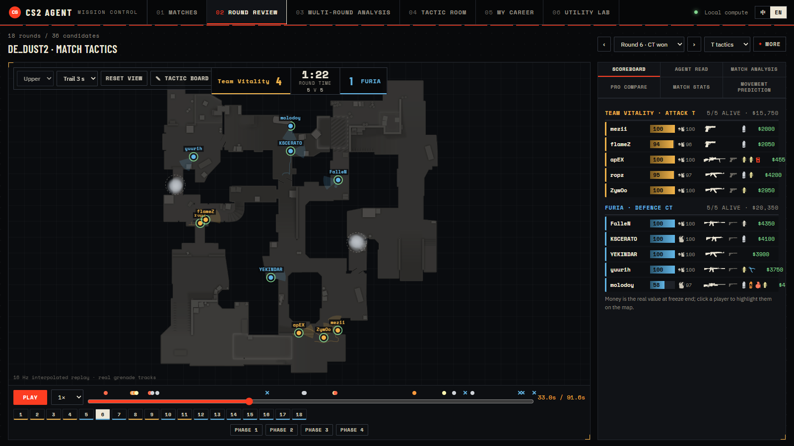
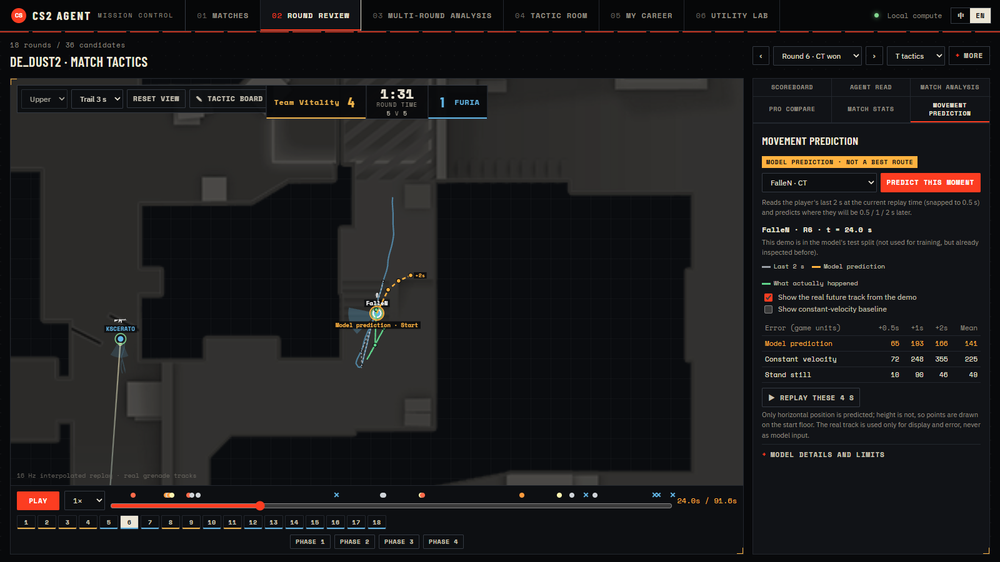
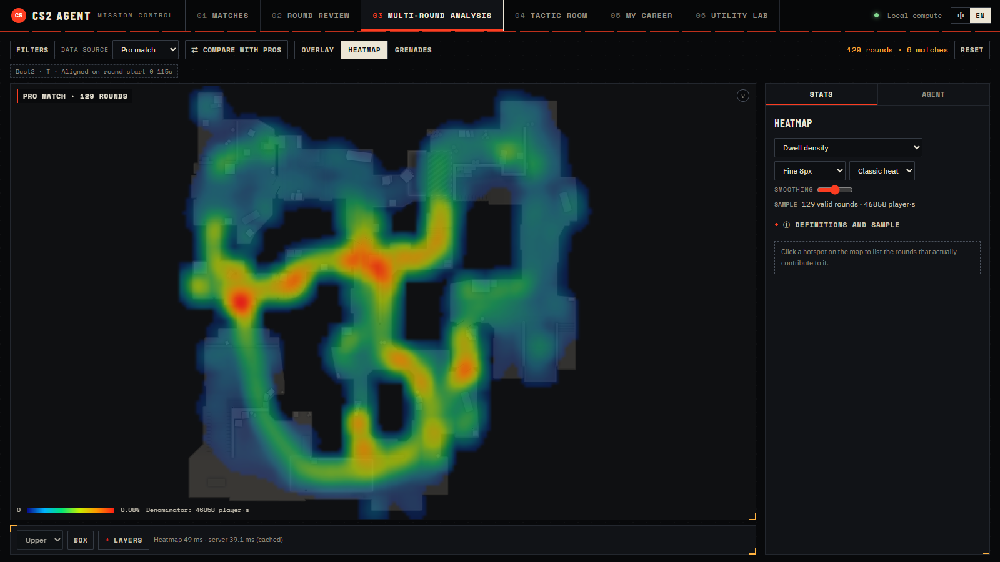
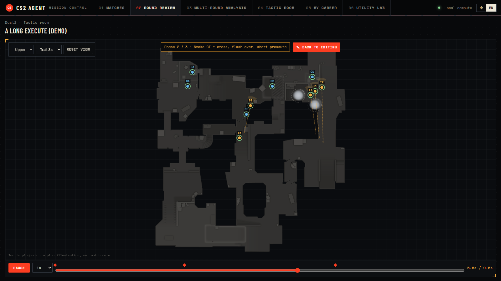
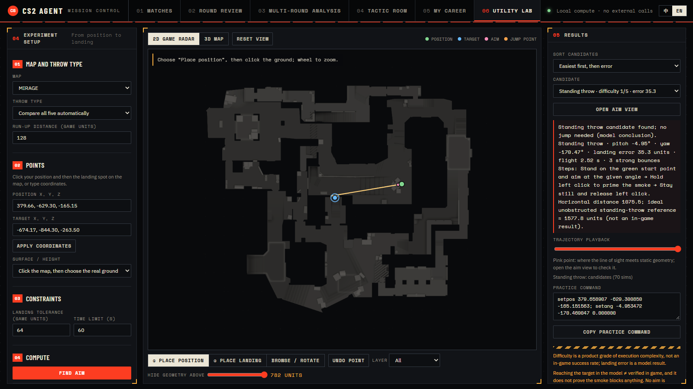
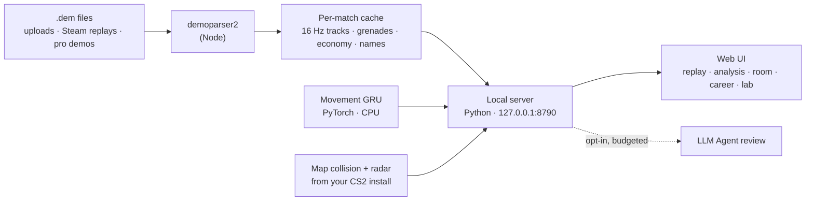
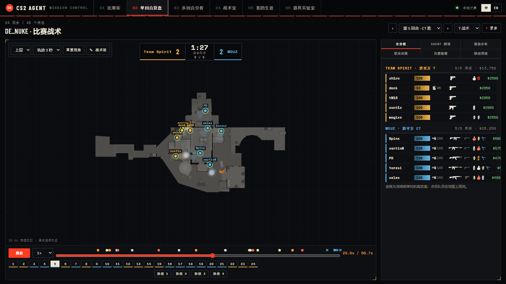

<div align="center">

# RoundCrafter

**Demo analysis for Counter-Strike 2: replay any match, let an AI analyst explain it with evidence,<br>study patterns across rounds and plan tactics. Runs on your own machine.**

[English](#english) · [中文](#中文)



</div>

---

<a id="english"></a>

## Why

Most demo viewers only play a match back. RoundCrafter turns your CS2 `.dem` files into a workspace you can study. It replays rounds at 16 Hz with real utility, finds patterns across many rounds, keeps a library of your own plans, and runs a small movement model you can check against the real track. Everything runs on your own machine. The only exception is the Agent review, which is opt-in.

## Features

### 01 · Round review: a 2D replay that reads like a broadcast
- 16 Hz interpolated playback with real player names, HP/armor bars, the weapon in hand and full loadout icons.
- Real grenade trajectories, plus smoke, molotov, flash and HE effects, shot tracers and a kill feed.
- Live score, freeze-time economy, round strip and event ticks on the timeline. On two-level maps such as Nuke you can switch between the upper and lower radar.

### 02 · Movement prediction: a model next to the truth


Pick any player at any moment, and a local GRU predicts where they will be **0.5 s, 1 s and 2 s** later. The panel then shows the real future track from the demo next to the prediction. Errors are compared against "keep the same speed" and "stand still" baselines.

| Held-out test demos (101,821 windows) | Mean error (game units) |
|---|---:|
| **Model** | **65.2** |
| Constant-velocity baseline | 71.7 |
| Standing still | 100.9 |

- It is labelled as a *model prediction*, not a best route: it learns how pros typically move.
- The real track is used only for display and scoring. It never reaches the model input.
- Inputs it can't trust are refused rather than zero-filled: unsupported map, less than 2 s of history, or fewer than 10 players.
- Full validation, including the cases where it is wrong: [`outputs/movement/web/`](outputs/movement/web/移动预测网页接入-验证报告.md).

### 03 · Multi-round analysis: patterns, not single rounds


- Filter by map, side, economy, opening and players, then overlay every matching round on one map.
- Dwell, reach, scoped, kill and death heatmaps with Gaussian smoothing and an honest sample denominator.
- Grenade clustering: where utility actually lands, grouped by type, side and floor.
- **Compare with pros:** put your matches side by side with professional reference demos.
- An optional, budgeted Agent explains the evidence, and every claim links back to a playable clip.

### 04 · Tactic room: plan it, then play it


- A personal library of tactics with tags, folders, notes and duplication.
- Multi-stage board with players, routes, smokes, flashes, molotovs, HE grenades, arrows and text, on both floors.
- **▶ Play** turns the stages into an animated round in the same replay engine as real demos.
- Start a plan straight from any moment of a real match.

### 05 · My career: your Steam account, tracked
- Sign in with Steam (OpenID) to link your account. New match share codes are detected, and demos in your replays folder are imported automatically.
- Per-match Rating 1.0, a Rating 2.0 approximation, ADR (capped at the victim's remaining HP), KAST with 5-second trades, opening duels and HS%.
- Jump from any match straight into its replay.

### 06 · Utility lab: find a lineup with physics


- Click where you stand and where the grenade should land. The lab searches standing, jump, W-jump, crouch-jump and run-jump throws against the map's real collision geometry.
- It returns aim angles, flight time, bounces and a `setpos/setang` practice command, in 2D radar or 3D view.

### Bilingual
Every screen switches between **中文 / English** with one click. Agent answers follow the selected language.

## How it works



## Quick start

Requirements: Windows, Python ≥ 3.12, Node ≥ 22 and a local CS2 install (for radar images and icons).

```powershell
python -m venv .venv
./.venv/Scripts/python.exe -m pip install -e ".[test]"
./.venv/Scripts/python.exe -m pip install -r requirements-training.txt   # PyTorch, for movement prediction
npm install --prefix outputs/cs2-coach-prototype                          # demo parser
./start-tactics.ps1
```

Open **http://127.0.0.1:8790**, upload a `.dem` file (or link Steam), and open the match.

- Weapon icons are imported from your CS2 install with `experiments/import-icons.ps1`.
- Movement prediction needs the trained checkpoints in `outputs/movement/comparison/`. These are local artifacts, not stored in git.
- The Agent review is optional. Configure a model endpoint in `.env` (see `.env.example`).

## Privacy and trust

- **Local by default.** The server binds to `127.0.0.1`, checks Host/Origin, and requires a per-session token for every write.
- **Your keys stay yours.** You enter the Steam Web API key in the UI. It is stored in `data/account/secrets.json` and never sent back by the API.
- **No silent model calls.** The LLM is called only when you click, and each run has a call budget.
- **Honest outputs.** Model results are labelled as such, inferences are separated from observed facts, and the validation reports in `outputs/` include the failure cases.

## Project layout

```
backend/cs2_agent/   server, demo processing, stats, Steam hub, tactic room, movement inference, agents
backend/eregion/     AgentLoop runtime
web/                 UI: replay engine, analysis workbench, tactic board, lab
experiments/         demo extraction scripts and the movement-model training code
tests/               pytest suite
outputs/**/*.md      validation reports
docs/                images and the research log
```

```powershell
$env:PYTHONPATH='backend'; ./.venv/Scripts/python.exe -m pytest -q
```

---

<a id="中文"></a>

## 中文

<div align="center">

**RoundCrafter：本地运行的 CS2 demo 分析工具。回放比赛，让 AI 分析师基于证据解读，<br>跨回合找规律、规划战术。**



</div>

### 为什么做它

大多数 demo 播放器只能“放一遍”。RoundCrafter 把 CS2 的 `.dem` 变成可以研究的工作台：

- 16 Hz 回放，包含真实道具效果
- 跨回合统计规律
- 保存自己的战术
- 用小模型预测走位，并直接对照 demo 里的真实轨迹

除了可选的 Agent 复盘，全部计算都在你自己的电脑上完成。

### 功能

| 模块 | 你能做什么 |
|---|---|
| **01 单回合复盘** | 16 Hz 插值回放，带真实选手名、血甲、手持武器与完整装备图标；烟、火、闪、雷效果和真实道具轨迹，开枪线和击杀信息；比分、冻结期经济；Nuke 等多层地图可切换楼层 |
| **02 移动预测** | 任选一名玩家和一个时刻，本地 GRU 预测其 0.5 / 1 / 2 秒后的位置，并与 demo 真实后续对照；同时给出“匀速外推”“原地不动”两个基准的误差。标注为**模型预测**，不是最优路线 |
| **03 多回合分析** | 按地图、阵营、经济、开局、玩家筛选并叠加回合；停留、可达、开镜、击杀、死亡热力图；道具落点聚类；我的比赛与职业对照；可选的限额 Agent 解读，每条结论都能回到片段 |
| **04 战术室** | 个人战术库，支持标签、文件夹、备注；多阶段战术板，可放置队员、路线、烟闪火雷、箭头和文字，支持上下层；**▶ 演示**用回放引擎把方案播放成一回合 |
| **05 我的生涯** | Steam 登录绑定；自动读取分享码和本地录像目录；每场 Rating、ADR、KAST、首杀和爆头率；一键跳转到回放 |
| **06 道具实验室** | 点选站位和落点，基于真实碰撞几何搜索站投、跳投、W 跳投、蹲跳投、助跑投；给出角度、飞行时间、反弹和 `setpos/setang` 练习指令 |

**移动预测在测试集上的表现**（16 场未参与训练的比赛，101,821 个窗口）：模型平均误差 **65.2** 游戏单位，匀速外推 71.7，原地不动 100.9。完整验证（包括预测失误的片段）见 [`outputs/movement/web/`](outputs/movement/web/移动预测网页接入-验证报告.md)。

| 移动预测 | 热力图 |
|---|---|
|  |  |
| **战术板演示** | **道具实验室** |
|  |  |

### 快速开始

需要 Windows、Python ≥ 3.12、Node ≥ 22，以及本机安装的 CS2（用于雷达图和图标）。

```powershell
python -m venv .venv
./.venv/Scripts/python.exe -m pip install -e ".[test]"
./.venv/Scripts/python.exe -m pip install -r requirements-training.txt   # 移动预测需要 PyTorch
npm install --prefix outputs/cs2-coach-prototype                          # demo 解析器
./start-tactics.ps1
```

打开 **http://127.0.0.1:8790**，上传 `.dem` 或绑定 Steam，然后打开比赛。

- 武器图标通过 `experiments/import-icons.ps1` 从本机 CS2 导入。
- 移动预测需要 `outputs/movement/comparison/` 下的模型权重。这些是本地产物，不在 git 中。
- Agent 复盘是可选功能，需要在 `.env` 中配置模型服务（参考 `.env.example`）。

### 隐私与可信度

- **默认本地：** 服务只监听 `127.0.0.1`，校验 Host/Origin，所有写操作都需要会话令牌。
- **密钥留在本机：** Steam API Key 在网页中填写，保存在 `data/account/secrets.json`，接口不会返回它。
- **不偷偷调用模型：** 只有点击后才调用 LLM，每次都有调用上限。
- **结果诚实：** 模型输出明确标注，推断与观测事实分开，`outputs/` 中的验证报告包含失败案例。

早期实验记录见 [docs/research-log.md](docs/research-log.md)。
