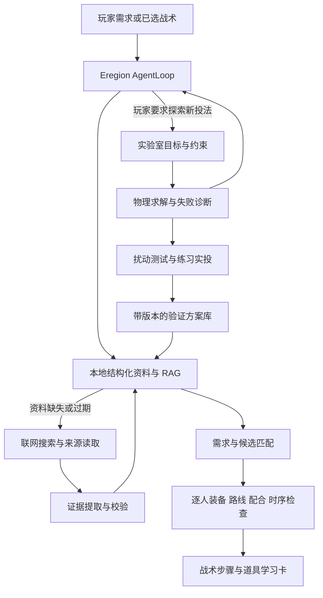

# CS2 Agent 产品与实施方案 v2：战术助手 + 道具实验室

日期：2026-10-13  
状态：当前实施方案；本文件描述待开发能力，不代表功能已经上线。  
替代方案：`LLM-Agent战术道具求解-完整实施计划.md`（v1 留作历史记录）。

## 1. 本次重新设计的决定

产品分为两个入口，共用同一个 Agent 核心、知识库和证据体系。

**战术助手是近期主线。** 根据玩家需求和队伍条件，检索战术与现成道具；库内不足时由 Agent 上网搜索，核对来源和适配条件，自动组织成玩家能执行的步骤。

**道具实验室是独立的探索功能。** 玩家提出新战术或道具需求，Agent 将需求转成约束，调用模拟器搜索和调整候选，再提供练习测试与实投验证入口。

现成道具的查找与教学不依赖模拟器先达到高精度。模拟器继续开发，但不再阻塞日常助手上线。第一版不训练模型，不建设全站视频下载流水线，不以“最高胜率”为产品承诺。

## 2. 两个入口的用户体验

|入口|玩家可以怎么说|Agent 的任务|最终交付|
|---|---|---|---|
|战术助手|“这套 Nuke 战术里的 Heaven 烟怎么扔？”|检索已知投法，补充搜索并核对|来源链接、投掷方式、操作说明、可获得的定位指令|
|战术助手|“我们三个人，有两烟三闪，想打 Ramp。”|匹配可用资料，检查人数、逐人道具和配合条件|适配的行动建议、每人职责、缺失条件和替代方案|
|战术助手|“我单排，想学一个自己能用的外场烟。”|限制为单人可执行条件，查询已有投法|无需队友配合的学习卡；依赖队友的条目明确排除或标注|
|道具实验室|“从这个屋顶区域封住这条枪线，尽量站投。”|定义目标、搜索候选、精算、验证容错|实验轨迹、定位指令、操作方法、未验证条件|
|道具实验室|“已有投法需要跑投，能设计一个站投替代吗？”|参考已有用途，固定目标后探索新起点和角度|新候选与原投法的区别、取舍及实投任务|

用户选择战术后，Agent 应主动检查所需道具并补资料，不要求玩家对每颗烟逐次提问。搜索和验证在预算内自动继续，只有关键条件无法推断时才集中询问。

## 3. 产品范围与优先级

### P0：先交付一条有用的检索闭环

- Nuke 的现有战术作为端到端样例，覆盖已关联的六个道具页面。
- 支持按用途查找已有投法、查看原始教学来源、匹配逐人道具和动作顺序。
- 同时提供单人学习入口，不能把五人齐全作为所有功能的前提。
- 支持本地知识库命中；缺失时走联网搜索；合格证据缓存后下次复用。
- 保留时序检查，但资料不完整时展示未知，不编造精确秒数。

### P1：扩大检索型助手

- 增加来源适配器、其他地图和战术类型。
- 按当前装备、经济及对手习惯改善战术筛选。
- 逐步接入 demo 提取的当前回合状态；手工输入始终作为第一版可用路径。
- 记录来源变化、失败反馈与已失效条目。

### P2：独立实验室

- 先支持引擎已经声明可用的地图和投掷方式。
- 从自然语言目标生成受约束的搜索任务。
- 继续释放、碰撞和烟雾效果校准；通过实投后才进入验证方案库。

这里的优先级不是固定工期。实验室可以持续推进底层研究，但不能占用检索助手的上线前置条件。

## 4. 共用架构

Agent 负责理解、选择工具、安排搜索和解释。工具负责访问资料、提取证据、数值计算与硬约束检查。把模型写出一段建议和真正完成这些步骤区分开来。

网页里的外部资料、视频说明和评论只是证据，不能改变 Agent 的预算、工具权限或系统任务。

## 5. 战术助手的完整工作流

### 5.1 明确需求，但减少输入负担

从玩家当前页面、已选战术、已知 demo 状态或自然语言中提取：地图、阵营、角色、人数、配合程度、当前道具、目标位置和动作限制。

缺失字段分成两类：

- 不影响找资料：先检索，结果标出适用条件。
- 会改变可执行性的关键字段：集中询问，例如实际可配合人数、谁持有唯一烟雾弹。

若只想学习一颗烟，不强求玩家先填写完整经济和五人阵容。

### 5.2 库内检索优先

第一层使用结构化过滤：地图、区域别名、道具类型、起点、目标、动作方式、适用版本和证据状态。

第二层使用关键词检索和中文/英文地名别名；需要时再增加向量召回，用于“掩护外场过点”等目的描述。向量相似度只能帮助找资料，不能决定道具是否适配。

命中可用资料后检查来源新鲜度和缺失字段。不是每次请求都重新搜索互联网。

### 5.3 缺少资料时自动联网

Agent 根据缺口生成查询，例如“地图 + 起点 + 目标 + 道具 + 投掷方式”。优先查看原始教学条目、原作者视频或已有可信资料站。

首批候选来源包括用户已提供的 MetaStack、CS2.app，以及它们引用的原始教学视频。各来源是否有可用 API、是否需要登录、允许读取哪些内容，需要实现适配器时验证，不能预设。

搜索发现 URL 后实际读取页面。搜索摘要、视频标题或缩略图只能作线索，不能直接升级成完整操作教学。

### 5.4 提取证据

提取地图、起点区域、目标区域、道具类型、站/蹲/跑/跳、投掷按键、分步操作、来源时间、页面或视频链接。定位指令仅在来源明确提供且成功读取时记录。

视频处理分级：

1. 先使用原视频链接与可验证的说明/字幕。
2. 文字足够时直接构建学习卡。
3. 关键动作只能通过画面确认时，按需检查有限片段或少量帧；无需整站下载和批量截图。
4. 不能访问或没有确认时，只交付原视频入口和已知条件，关键动作标为未知。

视频时间点必须来自实际检查、章节或可靠字幕对齐。不能凭猜测附上“这里是瞄点”的时间链接。

默认展示原始来源链接；不把第三方视频复制分发作为产品基础。

### 5.5 核对用途与兼容性

一个标题包含“Heaven”的条目不一定适用于该战术。至少检查：

- 是否相同地图与楼层，是否存在地图版本适配信息。
- 烟雾最终封住的方向是否满足战术目的。
- 投掷者能否从角色路线到达起点。
- 是否需要跑投、跳投、蹲下、特定出生位或队友配合。
- 道具类型和持有人是否正确。
- 飞行/生效时机是否会影响队友行动。
- 投完后的去向是否与后续职责冲突。

可以推荐资料供学习，但没有证据时不能宣称已证实战术效果或成功率。

### 5.6 生成逐人执行方案

把战术组织成角色卡，每张卡包括：准备位置、持有道具、触发条件、操作步骤、等待的队友事件、后续行动、教学链接与不确定项。

不因缺一颗道具就自动把五人战术改写成三人战术。替代方案必须有来源或明确标为待验证提议；无法补足时说明缺口，并提供仍可单独学习的部分。

### 5.7 缓存与复用

保留规范化 URL、条目 ID、提取时间、内容摘要/哈希和字段级证据。重复搜索优先复用已读取内容。来源内容变化后重检相关字段；验证失败或地图变化后降低结果等级。

页面可读、来源明确、战术适配和游戏实投分别记录。一次缓存成功不等于永久有效。

## 6. 知识库的重新组织

不把所有资料都塞进同一个向量库。采用“结构化记录 + 可检索原文 + 证据与版本”的组合。

|记录|用途|关键字段|
|---|---|---|
|TacticCard|保存战术及角色动作链|地图、阵营、人数、角色、目的、步骤、依赖、来源|
|UtilityNeed|描述战术缺少的道具能力|执行者、道具、起点限制、目标效果、时间与后续去向|
|LineupCard|已有投法资料|区域、投法、操作步骤、坐标（可空）、来源视频、必要条件|
|Evidence|支持具体字段|来源 URL、片段/时间点、获取方式、观察时间、支持字段、矛盾|
|CompatibilityResult|某个投法是否适配某项需求|已通过条件、冲突、未知、匹配版本|
|ExperimentRun|实验室搜索过程|目标定义、预算、工具版本、候选、诊断、调用日志|
|ValidationRecord|本地实投记录|地图版本、动作条件、重复次数、完整结果、失效原因|

### 6.1 三个独立的质量维度

- **来源证据**：仅发现线索 / 页面已读取 / 关键动作有证据 / 来源冲突。
- **任务适配**：不适配 / 关键条件未知 / 在给定条件下匹配。
- **游戏验证**：未验证 / 有可追溯实投记录 / 地图变化后待复验。

不做一个含糊的“已验证”标签掩盖这三个维度。

### 6.2 坐标与指令

坐标是可选字段。没有坐标但有清晰原视频的条目仍然可以作为学习资料展示，不因此阻塞助手。

提取到 `setpos / setang` 后，仅解析预期数值字段，核对格式、地图及姿态说明。网页附带的其他控制台命令不直接拼进复制内容。坐标真实来自页面也不代表投法已经实测。

### 6.3 地图版本

保存已知地图版本、来源发布日期、读取日期和最近实投日期；未知就留空。发布日期较新只能提高检查优先级，不能直接证明投法有效。尽量按地图/关键区域变化使相关条目失效，避免每次更新就无差别丢弃全部缓存。

## 7. Agent 工具重新设计

以下为拟新增接口，实施时复用已有工具而非重复建设。

### 7.1 战术助手工具：近期优先

|工具|作用|关键边界|
|---|---|---|
|`get_tactic_requirements`|拆出战术角色、步骤和 UtilityNeed|保留来源，缺项不补造|
|`search_local_lineups`|结构化过滤 + 关键词/RAG 召回|返回证据和适用条件|
|`search_web_lineups`|生成并执行有预算的联网查询|返回发现线索，不等于事实已核对|
|`read_lineup_source`|读取指定来源页面或视频说明|只用实际可访问内容|
|`inspect_video_segment`|按需核对有限片段|记录所见范围，不能把未观看视频当成已核验|
|`normalize_lineup_evidence`|整理字段和来源片段|校验每个关键字段是否有支持|
|`check_lineup_fit`|匹配角色、区域、动作方式和用途|冲突硬拒绝；未知单列|
|`check_team_execution`|逐人库存、动作依赖、时间与协作检查|复用已有 Nuke/角色检查能力|
|`save_lineup_card`|保存有证据且去重的条目|不能由 LLM 自行标为游戏实投通过|
|`compose_execution_plan`|生成逐人步骤与教学入口|输出前进行完整性校验|

### 7.2 道具实验室工具：保留独立路线

|工具|作用|
|---|---|
|`define_experiment_intent`|把新需求转为可检查的目的、区域、模式和时序|
|`inspect_map_target`|查询地形、目标枪线、起点范围及能力缺口|
|`start_lineup_search`|提交有限物理搜索|
|`get_search_result`|读取进度、候选和失败分布|
|`refine_lineup`|在允许范围内局部调整|
|`validate_lineup`|检查角度、站位、释放时序与效果|
|`export_practice_case`|输出候选数值生成的指令与操作步骤|
|`record_game_validation`|记录实际复投证据及成功/失败样本|

工具不能把“模型说成功”写成验证结果。使用本地不可混淆的任务 ID 和版本；修改需求后不复用旧约束下的成功状态。

## 8. 两条路线的切换规则

|情况|处理|
|---|---|
|库内已有完整适配条目|直接组织教学与战术步骤，不启动物理搜索|
|库内资料缺失|联网查找，读取来源，核对后缓存|
|资料只有视频|提供原链接与已确认条件；必要时按需检查片段|
|存在投法但不满足站位/动作限制|继续找适配来源；可提示实验室尝试替代|
|预算内没找到资料|报告“暂未找到”，不能断言世界上不存在|
|玩家明确要求设计新投法|进入实验室；先说明已有参考，再按新约束探索|
|求解器不支持所需模式或场景|返回具体能力缺口，不用未经校准参数制造候选|
|实验得到模拟候选|标记为实验方案，安排练习验证|
|有游戏实投证据|按验证范围进入已验证方案库，供助手检索|

普通查询未命中时，不自动启动无上限物理任务。可以在用户已选择实验模式后自主迭代；普通助手只提示可进入实验室。

## 9. 道具实验室重新定位

实验室是玩家提出需求、测试假设的地方，不承诺每个需求都能找到新投法。

### 9.1 玩家需求示例

“从屋顶能到达的区域封 Heaven，最好站投，投完能回 Ramp；队友在 1:40 开始动作。”

Agent 明确：硬要求是目标与角色路线；“最好站投”是偏好还是不能跳投需要由语义或简短确认确定。不能把偏好当绝对限制导致无解，也不能擅自忽略真正的限制。

### 9.2 搜索与验证

1. 查已有投法作为用途和可行性参考，但不冒充自己设计的新结果。
2. 固定有证据的目标定义、地图、角色区域和时间约束。
3. 在引擎支持范围内搜索，检查碰撞和目标效果。
4. 根据失败原因调整，不放宽硬要求凑结果。
5. 检查角度、起点及动作时序扰动，聚类去重。
6. 输出少量有实际取舍的实验方案和练习说明。
7. 记录游戏复投，失败时回到模型或目标定义修正。

玩家可能得到“满足目标但需要跳投”“站投要求下暂未找到”“该地图状态尚不支持”等不同结论。每个结论都要有工具证据。

### 9.3 物理工作的优先级

保留已完成的空中运动验证与连续碰撞，继续校准真实释放、碰撞形状、反弹、滚动及引爆。先在受支持的简单任务上获得实投闭环，再处理来源需要跑跳投的 Heaven 道具。

真实封烟验证不能用粗圆柱包络替代；落点距离近也不能证明有效。已有网络体素数据可以辅助，但网络占据不等于渲染不透明度。

原 v1 中的物理校准、四组搜索实验、版本记录仍可复用，移到实验室阶段，不再作为战术助手的发布门槛。

## 10. 普通玩家与队伍的统一设计

### 单人 / 单排

- 默认只推荐自己能完成的动作，优先低配合依赖的投法。
- 说明该道具能创造什么条件，以及自己后续怎么利用。
- 需要队友同时给闪、补烟或拉枪线的内容显式标注，不能当作单人可执行。

### 双排 / 三排

- 按实际配合人数分配动作；其余队友行为作为未知或假设。
- 不把职业五人战术机械裁剪成少人版。

### 五人队伍

- 根据逐人库存和位置分工，检查重复占用道具、前置口令与时序。
- 支持来源战术的完整教学和条件明确的变体。

### 经济与对手习惯的后续接入

经济优先影响当前能携带的道具和可购买方案；只有数据足够时才计算购买可行性。对手开局习惯来自明确的历史样本和时间范围，展示样本量与未知，不能假定下一回合必然重复。

第一版不要求这些数据齐全才能查一颗烟。自动解析回合状态和对手习惯属于后续增强，不与当前检索闭环捆绑。

## 11. 网站信息架构

### 首页

两个明确入口：**帮我执行战术**、**帮我设计新道具**。允许直接输入自然语言，也允许从已选战术发起任务。

### 战术助手页面

- 任务理解：地图、角色、目的和当前条件。
- 自动工作进度：查本地资料、补搜索、核对投法、检查配合。
- 执行方案：按玩家/角色排列步骤。
- 道具卡：动作方式、准备位置、用途、原始教学链接、可用坐标。
- 证据状态：来源是否读过、哪些条件匹配、是否有实投记录。
- 缺项与替代：用具体原因说明不能完整执行的地方。
- “尝试设计替代投法”：把已知约束带入实验室，不让玩家重填。

### 道具实验室页面

- 输入新需求、地图、起点范围和目标。
- 展示 Agent 正在尝试的方向与剩余预算。
- 3D 或 2D 查看轨迹、碰撞、目标区域和效果证据。
- 比较少量有差异的候选，复制练习指令。
- 记录复投结果，查看失败原因和地图版本。

已有 `/solver` 演进为实验室；现有战术库入口演进为助手。资料卡和三维组件复用。页面措辞以玩家任务为主，不堆放内部工具名。

## 12. 数据获取与成本控制

### 联网能力

需要给应用本身接入可用的搜索服务和来源读取工具。当前开发聊天可联网，不代表项目里的 Agent 已拥有同等联网能力；实现阶段必须单独验证并选择适配器。

搜索、页面读取和视频查看能力分别检测。遇到登录、不可访问页面或读取失败时保留状态，使用其他可访问来源；不能把工具失败写成资料不存在。

### 初始预算建议（计划值）

- 单颗道具查询：最多 3 轮查询、读取 8 个不同候选来源、6 次 LLM 调用。
- 整套首批 Nuke 战术：最多 12 次查询、读取 24 个去重来源、12 次 LLM 调用，共享缓存；优先补最影响执行的缺口。
- 单次实验室任务：最多 6 次 LLM 调用、1,000 次轨迹模拟、300 秒本地计算；扰动验证也计入模拟次数。

页面超时、模型输出 token 和费用另设上限。预算不是越多越好，要在先导实验后调节。任务可取消、可恢复；用户修改需求后丢弃过期决策。

外部调用只发送任务必要的描述和证据摘要；模型与搜索服务目的地、调用量保留记录，按已有明确授权范围执行。优先本地缓存，不重新发送整份 demo。

## 13. 实施路线与验收

|阶段|交付|验收标准|依赖|
|---|---|---|---|
|S0 方案与数据整理|新资料 schema、字段证据和质量状态；迁移现有六道具资料|既有资料不丢失，未知坐标仍为空，历史模拟记录保留|现有工程|
|S1 联网检索工具|搜索/读取适配器、去重缓存、预算、失败码|能由应用真实执行；区分未找到、不可读、未核验；来源字段可追溯|S0|
|S2 Agent 闭环|自动检索→补资料→检查适配→组织结果|一个请求能走完整流程，非法工具和预算超限被阻止|S1 + 现有 AgentLoop|
|S3 Nuke 战术助手|逐人步骤、单人学习、原始教学链接、装备与时序检查|六项需求逐一显示已有证据和缺口；不要求全部伪装成已解决|S2|
|S4 检索质量验收|任务集、来源核验、错误匹配测试、成本报告|可回答样本能给正确原始来源；缺证据任务能正确降级|S3|
|S5 实验室 Agent|需求结构化、搜索工具、失败调整、练习验证记录|独立于助手运行；能报告不支持/无结果，不能靠放宽约束成功|现有求解器 + S2 共用框架|
|S6 物理与实投闭环|小型校准数据和至少一个新候选的复投流程|报告全部试验；区分实际成功与失败，不要求每次需求有解|S5 + 游戏验证条件|
|S7 扩展|其他地图、更多道具、经济/对手习惯、已验证方案复用|每项能力有独立质量与成本证据|助手和实验室分别达到其前置条件|

**近期第一交付物是 S1–S3 的检索型助手，不能再被 Heaven 新投法是否求出阻塞。**

S5/S6 不因先导搜索无结果而拖延战术助手。两条路线共享基础设施，但各自有可用性指标。

## 14. 检索助手的验证计划

### 14.1 任务集

先建立 20 个小型检查任务，包括：已知可读投法、中文/英文地名别名、起点不适配、错误地图或楼层、单人无法完成的配合、缺道具、缺坐标但视频可用、只有标题线索、来源冲突、预算内无结果。

使用明确标注的参考答案与证据。不能让同一个模型既生成未经核验答案又宣布自己回答正确。

### 14.2 核心指标

- 来源真实存在且内容支持答案的比例。
- 地图、起点、目标、动作方式和协作条件的匹配准确性。
- 关键字段有证据的覆盖率。
- 编造坐标、编造视频时刻和虚假实投标记的数量。
- 完整需求与部分可回答需求的正确分流。
- 首次回答耗时、来源读取量、模型用量与缓存后成本。

初始工程验收：测试集中不得出现编造坐标或虚假实投通过；所有关键缺项必须显式显示。对已知可回答任务，以至少 80% 正确返回适配资料为首轮改进门槛，并报告分母；它不是对真实全网准确率的承诺。

### 14.3 实验室单独评估

保留固定网格、随机搜索、确定性粗到细、LLM Agent 四组对照；地图、目标、能力和模拟预算一致。比较实投结果、容错、时间和成本，不能用联网检索成功替代自主设计成功。

“找到别人已有投法”和“求解器产生的新候选”在实验报告中分别统计。若 Agent 调度不优于普通启发式，则保留需求解释，把搜索交给更便宜的方法。

## 15. 工程复用与新增模块

### 继续复用

- `backend/eregion/runtime/core/`：AgentLoop。
- `backend/cs2_agent/host.py`、`provider.py`、`tools.py`：业务与模型/工具接入。
- `tactics_rag.py`、`tactics_tools.py`、`learning_resources.py`：检索与资料入口。
- `nuke_teaching.py`：角色、库存、顺序和时间检查。
- `tactical_solver.py`、`grenade_search.py`、`projectile_collision.py`：实验室基础。
- `web/tactics.*`、`web/tactical-solver.*`：现有界面。

### 拟新增（计划命名）

- `lineup_catalog.py`：资料 schema、去重、来源与质量状态。
- `lineup_sources/`：搜索、页面和视频说明适配器。
- `lineup_research_tools.py`：Agent 联网研究工具。
- `lineup_matching.py`：需求与投法适配检查。
- `tactic_execution_plan.py`：逐人执行方案组织。
- `agent_jobs.py`：共用异步任务、取消、预算与恢复。
- `solver_tools.py`：实验室操作工具。
- `data/knowledge/lineups/`：结构化资料与字段证据。
- `outputs/lineup-research/<run_id>/`：检索过程、结果和成本。
- `outputs/solver/runs/<run_id>/`：实验室运行记录。

具体文件拆分可随实现调整，不为追求模块数量重写已有核心。第一版优先结构化存储和关键词检索；确有召回瓶颈再引入复杂向量基础设施。

## 16. 下一次开发的具体清单

1. 定义 LineupCard、UtilityNeed、Evidence、CompatibilityResult，并迁移现有 Nuke 六个条目。
2. 盘点应用可用的搜索服务，完成一个真实搜索适配器和一个可用页面读取适配器。
3. 实现本地优先检索、规范化 URL 去重、字段证据与缓存。
4. 加入 Agent 工具循环，使用离线测试覆盖来源不足、错误匹配、预算耗尽和取消。
5. 用“这套战术里的 Heaven 烟怎么扔”完成一次真实端到端研究，返回来源与明确缺项。
6. 接入其余道具，输出逐人卡片，同时提供单人查询入口。
7. 写首轮 Markdown 报告，再根据错误分布扩展来源和地图。

这一批不要求新增视频批量下载、不要求求出新的 Heaven 烟，也不要求完成全队经济预测。

## 17. 报告与完成定义

每轮结果仍写为 Markdown，包含实际完成内容、证据范围、未完成项、任务样本、测试结果、外部调用用量、页面截图和下一步。

建议报告：

- `outputs/lineup-research/战术道具联网检索-先导报告.md`
- `outputs/lineup-research/Nuke逐人执行助手-验证报告.md`
- `outputs/lineup-research/来源匹配与缓存-质量报告.md`
- `outputs/solver/reports/Agent新道具实验室-验证报告.md`

### 战术助手首版完成条件

- [ ] 应用中的 Agent 能真实联网补资料，并复用本地缓存。
- [ ] 玩家一次提出需求后，Agent 自动完成检索、来源核对和适配检查。
- [ ] 能输出 Nuke 样例逐人执行步骤，缺少资料时明确降级。
- [ ] 单人用户能直接查找自己能完成的投法。
- [ ] 原始教学链接可用；坐标、时间点与动作说明都有对应证据。
- [ ] 库存、人数与时序冲突有明确提示，不生成表面完整的错误计划。
- [ ] 质量任务集、预算、取消与缓存测试通过，Markdown 报告齐全。

### 实验室首版完成条件

- [ ] Agent 能把新需求变成有约束、可取消、有预算的搜索任务。
- [ ] 候选来自物理计算，与检索到的现成投法清楚区分。
- [ ] 不支持、预算耗尽和有限搜索无结果有独立状态。
- [ ] 实验候选附带轨迹、操作说明和验证方法。
- [ ] 至少完成一次“需求→候选→游戏复投→记录反馈”的完整过程；失败也必须记录。
- [ ] 只有经过相应实投验证的方案进入已验证库。

本文件是重新设计后的执行依据；以上待办未完成，不因计划写入而视为已交付。
