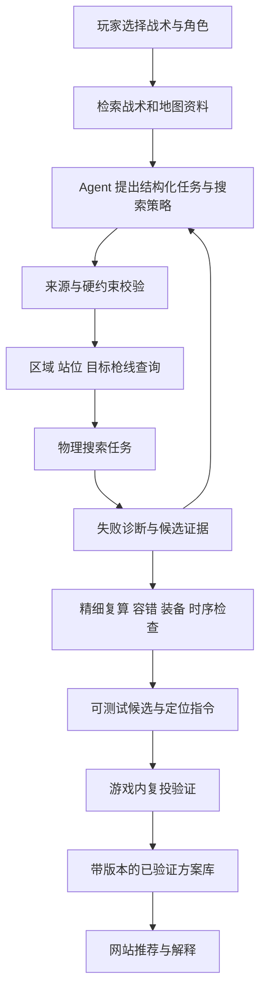

# CS2 战术驱动道具求解：LLM Agent 接入与完整实施计划

> 历史方案：当前实施顺序已由 [CS2 Agent 双路线产品方案 v2](CS2-Agent双路线产品方案-v2.md) 替代。本文的物理校准与实验设计保留供道具实验室参考。

版本：v1.0  
日期：2026-10-13  
项目目录：`C:\Users\zhiyu\Documents\Cs2-agent`  
性质：后续实施计划；阶段目标、预算和验收阈值是计划值，不代表已经实现或验证。

## 1. 最终要交付什么

玩家选择战术和执行角色，系统从战术描述中确定需要的道具用途、投掷区域、目标枪线、时间窗口和后续路线。Agent 调用地图、物理搜索、容错和执行条件检查工具，自主尝试并解释方案。网站展示轨迹、道具效果、投掷方式和可以复制到练习服的 `setpos / setang` 指令。

第一阶段的成功标准是：找到少量符合战术用途、操作可复现且完成游戏内验证的投法，并证明 Agent 的搜索策略有实际价值。暂不追求全地图、全道具、完整比赛决策或胜率预测。

产品分工：

- RAG 提供战术原文、角色步骤、道具需求与出处。
- LLM Agent 理解目标、制定搜索策略、解释失败和调整下一次搜索。
- 地图与物理工具计算坐标、轨迹、碰撞和局部扰动结果。
- 约束检查器判定角色、站位、装备、时序和目标是否一致。
- 游戏实投验证最终决定方案能否作为可靠练习道具交付。

无需先训练新模型。复用本项目已迁移的 Eregion AgentLoop，以及项目独立 `.env` 对接的模型服务。核心开发、离线测试不消耗外部模型调用。

## 2. 当前已经有什么，哪些尚未完成

|部分|当前基础|不能据此声称的能力|
|---|---|---|
|Agent 核心|已迁移 Eregion AgentLoop、Host、工具注册和模型适配器|尚未让 Agent 自主提交并修正道具搜索|
|战术库|已保存 Nuke 示例的角色、步骤、道具与来源|任意战术描述自动转成完整可执行约束|
|现有 Agent 工具|查看求解结果、检查时间、战术检索、逐人条件检查|Agent 已能控制求解过程|
|地图|本地 Nuke 静态碰撞三角面|完整导航可达、动态门和可破碎物状态|
|轨迹|重力、初始抛出模型、球形连续碰撞、碰撞后剩余 tick|已准确复现 CS2 实际碰撞形状、初速度、反弹和引爆|
|重力验证|7 场估计、3 场留出；4,291 / 2,030 个平稳飞行片段；误差 P95 约 0.156 单位|全轨迹或真实出手的同等精度；筛选使用完整片段信息|
|目标判定|区域距离与 8 条代表性枪线的粗圆柱包络相交|真实烟雾体素遮挡、准确 Heaven 门洞封烟|
|搜索|266 组组合，当前合格候选为 0|当前已经产出可用定位指令|
|网站|轨迹、假设枪线、拒绝原因、时间检查|成熟的 Agent 搜索交互和成功方案库|

必须纠正的实验设置：来源 Heaven 道具标注跑动跳投，而现有搜索只支持站立左键。站投无解不能用于评价原战术，也不能据此判断 LLM 是否有效。后续应先选出物理引擎真正支持的任务，再做 Agent 对照实验。

## 3. 首版边界与原则

### 3.1 先做的范围

- 地图：Nuke。
- 道具：烟雾弹。
- 战术：已有 GL A Fake to Ramp Pop Forcebuy；优先处理有明确来源的烟雾任务。
- 投掷方式：先校准站投；完成跳投和跑跳投实测后，再用于需要这些动作的任务。
- 用户场景：本地练习与赛前准备；无需制作第一人称瞄点图片。
- 输出：合理的站位、视角、投掷动作、效果证据、容错结果、时间条件与练习指令。
- 时间：保留投掷窗口、前置动作和后续去向；缺少可达路线耗时就保持未知。

### 3.2 暂缓内容

- 全地图并行开发、燃烧弹铺火、闪光致盲强度及 HE 伤害优化。
- 全站视频采集和批量瞄点截图。
- 训练新模型、完整五人对抗模拟、实时比赛接管。
- 动态门、玻璃破碎等尚未支持的状态组合；相关路径明确标为不支持。
- 没有对局实验支持的“最高胜率”“最优战术”等排名。

### 3.3 必须保持的约束

1. Agent 通过区域 ID、目标 ID、模式和搜索范围操作工具；不能直接凭文本生成被当成真值的坐标。
2. 数值候选来自求解器，练习指令由经过格式校验的数值生成。
3. Agent 可以提出替代方案，但不能自行放宽角色区域、装备、目标用途或安全检查来制造成功。
4. 模型、地图、目标定义和工具输出都有版本；结果必须可回放。
5. 搜索无解、预算耗尽、物理不支持、目标不明确是不同状态，不能合并成“没有投法”。
6. 练习定位不等于复现速度和跳跃阶段；跑跳投必须附加操作过程与验证证据。

## 4. 系统结构

物理计算在本地工作任务中执行。Agent 提交后通过任务 ID 获取摘要，避免把数百条完整轨迹塞进模型上下文。完整轨迹和碰撞证据留在本地，模型按需读取。

## 5. 战术任务与数据结构

### 5.1 TacticalIntent：战术意图

每项意图至少包含：

- `tactic_id / role_id / action_id`：关联战术、角色和独立动作。
- `map_id / map_hash / side`：地图版本与阵营。
- `source_refs`：来源片段、页面 URL、库版本。
- `purpose`：需要封锁的观察方向或保护的路线。
- `allowed_origin_region_ids`：允许搜索的站位区域。
- `target_spec_id`：目标枪线/开口及有效落地区域的已保存定义。
- `supported_throw_modes`：当前引擎可计算且已声明验证级别的模式。
- `inventory_requirements`：投掷者需要的道具与已消耗动作。
- `release_window / dependencies / next_region_id`：时间窗口、前置动作、后续去向。
- `hard_constraints / soft_preferences / unknowns`：明确区分禁止项、排序偏好、未知事实。

字段需要分别标记 `source_fact`、`model_proposal`、`product_policy`、`measured` 或 `unknown`。例如 1:46 来自来源描述；2 秒容差是产品策略；不能把二者混为同一种事实。

### 5.2 TargetSpec：战术效果定义

不能继续只用地名中心加一个大半径表示 Heaven 烟。目标定义需要：

- 要封锁的开口/观察区域与需要保护的路径。
- 分层高度、代表性视点和枪线集合。
- 可接受的烟雾落点区域与效果检查方法。
- 未知/固定的门、玻璃等状态。
- 标定来源、审阅状态和适用地图版本。

优先建立一小份经过核验的 Nuke 语义区域目录。模型可以从目录选择目标或提出待核验目标，不直接创造精确门洞坐标。

### 5.3 Candidate 与 Run

候选保存站位、视角、模式、释放状态、轨迹、碰撞记录、目标检查、容错测试、路线/时间检查、验证等级和指令。搜索运行保存输入、随机种子、物理/地图/模型版本、预算、调用次数、失败分类及所有候选 ID。

结果等级：

|等级|含义|网站行为|
|---|---|---|
|`diagnostic_only`|不满足约束，或缺关键前提|显示失败原因，不作为可用投法|
|`simulation_candidate`|通过当前模拟条件|可用于明确标注的练习测试，不能标为实投通过|
|`game_verified`|完成记录充分的游戏内重复验证|进入已验证方案列表|
|`stale`|地图、物理或目标版本变化|需要重新验证|

## 6. Agent 工具接口计划

以下为拟新增接口，不代表已存在。

|工具|主要输入|主要输出|
|---|---|---|
|`get_tactical_intent`|战术、角色、动作 ID|来源步骤、约束、缺失项|
|`query_map_regions`|地图、区域 ID、查询类型|允许站位、层高、可达性及证据状态|
|`inspect_smoke_target`|目标 ID|枪线、开口、目标区域、验证状态|
|`start_lineup_search`|意图 ID、区域子集、模式、角度范围、预算|任务 ID、实际接受的约束和预算|
|`get_search_result`|任务 ID、游标|进度、候选摘要、失败分布|
|`inspect_candidate`|候选 ID、所需证据项|碰撞位置、落点、目标检查细节|
|`refine_lineup`|候选 ID、允许的局部调整范围|精细搜索结果及成本|
|`validate_lineup`|候选 ID、验证配置 ID|角度/站位/释放时序扰动结果|
|`check_tactic_execution`|候选、队伍状态、时间信息|装备、前置动作、可达性、时序冲突|
|`export_practice_case`|候选 ID|定位指令、操作步骤、本地验证记录模板|

后端按照意图 ID 重新加载硬约束，不信任模型重复提交的宽松版本。导出工具使用工具数据库中的数值，不能接受任意命令文本。数值必须有限、地图/候选版本必须一致。

## 7. Agent 如何搜索

### 7.1 运行循环

1. 获取战术意图与来源。
2. 查询工具能力，检查所需投掷模式是否支持。
3. 检查目标是否足够明确；缺关键标定时返回缺项。
4. 提出有依据的初始区域和搜索范围。
5. 提交有限搜索，等待并读取结构化结果。
6. 根据失败分布选择一次调整，并写明依据。
7. 对候选做精细复算和扰动检查。
8. 检查逐人装备、前置事件和时间。
9. 输出候选或明确停止原因。

### 7.2 允许的调整例子

- 大量轨迹撞在同一屋顶构件：在允许区域内换起点或改变弧线，不把碰撞关掉。
- 所有轨迹射程不足：查询已支持的其他模式；工具不支持跳投时停止该分支。
- 落点接近但不遮挡目标：检查目标枪线与可接受落地区域，不只扩大命中半径。
- 中心角度命中、扰动失败：搜索更宽容的角度或站位，不降低容错要求。
- 物理可行但赶不上时间：尝试有导航证据的更近站位；路线未知则报告未知。

### 7.3 停止与资源预算

首轮试验默认每个 Agent 任务最多 6 次模型调用、1,000 次轨迹模拟、300 秒本地计算。以上为工程初始预算，实测后调整。粗搜、细搜和扰动验证的模拟次数全部计入；所有策略共享同一计数口径。

另设模型输入/输出 token 上限和单任务费用上限。重复的标准化搜索请求直接复用结果，不重复计费或重算。连续两轮没有新增有效证据时停止并说明原因。预算不足不能自动提高限额或宣布目标完成。

## 8. 物理和地图精度路线

### 8.1 按层校准，避免参数互相补偿

1. **空中运动**：保留现有按 demo 文件分离的验证；增加不同高度、速度和方向的覆盖。
2. **释放模型**：记录实际玩家脚部/眼部位置、姿态、视角、按键方式、释放时刻、弹体初始位置和速度。
3. **碰撞模型**：确认引擎实际 hull 与碰撞过滤；测试平地、墙面、边缘、斜面、连续反弹、玻璃和特殊材质。
4. **静止与引爆**：检查低速滚动、停止判定、烟雾生效时间。
5. **跳投与跑跳投**：校准运动速度继承、跳跃阶段与释放时序，再允许进入搜索。

采用本地练习地图/服务器的可记录测试；先搭好验证记录与回放方式，再批量采样。不直接把第三方文档中的常数视为本机版本实测结果。

### 8.2 验收方式

- 几何单元测试验证算法；游戏数据验证引擎一致性，二者分别报告。
- 按完整投掷/地图区域划分校准和验证集，不能把同一轨迹的相邻帧随机分到两边。
- 报告逐帧误差、首次碰撞位置/时间、反弹方向、落点和生效时间。
- 第一轮可用 30 条受控站投建立校准集，另留至少 10 条不同角度/位置投掷验证。
- 初始工程门槛建议为留出投掷落点误差 P95 ≤ 16 单位、生效时间误差 P95 ≤ 0.2 秒；这是待评估的门槛，窄开口目标仍必须按真实封锁效果验收。
- 某类表面/动作未通过，就把该能力标为不支持，不用整体平均误差掩盖失败类别。

### 8.3 烟雾目标验证

现有圆柱包络仅作快速排除和诊断。最终需要在多个指定视点确认目标区域是否遮挡、是否漏缝、何时生效以及能保持多久。已有网络体素解析可作为证据来源，但网络占据不能直接当作渲染不透明度。

目标达成以实投效果为准；不以“落点距离小于阈值”替代。

## 9. 合理站位、装备与时序

### 9.1 站位和投掷方式

- 站位位于角色允许区域及正确楼层。
- 有可靠地面支撑，玩家身体空间不与地图相交。
- 从准备区域可导航到达；无法导航判定就标未知。
- 后续能回到战术要求的路线，不把角色放进不符合职责的位置。
- 排序优先考虑操作容错、简单动作、较少复杂反弹及合理的后续移动。
- 极高或极低俯仰角不是天然错误；结合可操作性和容错判断，不能仅因“看起来奇怪”就拒绝合理抛物线。
- 暴露风险需要敌方可能观察区域与地图遮挡证据。没有对手信息时只能说明假设，不能声称站位安全。

### 9.2 逐人资源

复用已有角色分配与装备检查。每个动作绑定执行者，累计消耗其实际道具；避免把不同玩家持有的道具合并成一个人的可执行方案。角色名称不能替代枪械购买要求。

### 9.3 时间

使用回合倒计时统一表示事件，内部换算成正向时间计算路径和依赖，避免倒计时方向错误。

区分到位时间、出手时间、飞行时间、烟雾生效时间、队友行动时间和后续转点时间。来源明确约束出手的，不能改成落地时刻；“烟已生效再进点”需要效果时刻证据。

初期接收用户或测试提供的耗时，标明来源；后续使用导航路径和行动速度模型估计区间。不能使用穿墙直线距离给出确定赶路时间。玩家状态变化后要重新检查。

## 10. 网站交付

### 页面流程

1. 选择战术、角色和目标动作。
2. 展示从来源提取的任务解释及缺失条件。
3. 点击“寻找投法”，Agent 自主执行有限搜索。
4. 页面显示当前阶段，例如检查目标、搜索屋顶区域、测试容错；不展示无关内部实现。
5. 返回少量有差异的候选，或明确说明无结果原因。
6. 打开候选查看 3D 轨迹、碰撞点、目标枪线与效果状态。
7. 复制练习定位指令，查看动作说明，记录游戏验证结果。

### 必备交互

- 可取消、刷新后恢复、断线重连；取消后不执行迟到结果。
- 显示总预算和实际消耗，不让网页重复点击启动重复任务。
- 诊断示例与可测试候选明显区分。
- 相似站位/角度/轨迹聚类去重，不用多条几乎相同方案凑数量。
- 比较动作难度、容错、装备和时间条件；不把这些分数包装成胜率。
- 地图/物理更新后给既有结果加待复验状态。

保留现有 `/solver` 为入口，逐步升级；原视频素材核验页面和 demo 回放保留，但不是这条主线的依赖。

## 11. Agent 是否真的有帮助：对照实验

### 11.1 四组策略

|组别|策略|目的|
|---|---|---|
|A|固定网格搜索|当前基线|
|B|带种子的随机搜索|排除“只是搜索得更多”的影响|
|C|确定性粗到细启发式|衡量普通工程优化的收益|
|D|LLM Agent 引导工具搜索|衡量语言理解和动态调整的增量|

所有组使用相同地图、目标、动作支持范围、物理版本、硬约束及总模拟预算。LLM 成本和等待时间单独记录；D 组不能获得其他组没有的已知答案。扰动验证也计入预算。

### 11.2 分两轮进行

- 冒烟试验：先选 4 个受支持的任务，每项 Agent 最多 6 次调用；先验证完整闭环与成本记录。
- 正式小实验：建立约 20 个目标任务，包含已知可行、合理但困难、物理不支持和约束冲突案例；每个随机策略至少 3 个种子。
- 已知可行样本应由独立游戏实测建立，真实投法仅作为评估答案，不放进 Agent 提示词或搜索种子。
- 目标定义和阈值先冻结，再运行各组；更改后开启新一轮实验，不覆盖旧结果。

### 11.3 衡量指标

- 通过硬约束和模拟验证的任务比例。
- 游戏内验证成功比例及样本数。
- 首个合格结果所需模拟数、耗时、模型 token 和费用。
- 操作扰动容错、候选多样性、重复搜索率。
- 对无解、预算耗尽和不支持模式的区分能力。
- 角色/区域/装备/时序违规与没有证据的成功宣称。

20 个任务只足以指导原型选择，报告逐任务结果与不确定性，不直接宣称统计上证明优越。若 Agent 不优于确定性启发式，就让其保留战术解释功能，搜索调度继续使用成本更低的方法。

## 12. 实施阶段、依赖与验收

|阶段|主要工作|验收标准|依赖|
|---|---|---|---|
|P0 基线冻结|保存当前代码/结果版本、能力表、失败分类和重复项去重|结果可复跑；无解/不支持/预算耗尽明确区分|当前工程|
|P1 工具闭环|搜索任务队列、工具接口、进度/取消/缓存、Agent 接入|测试模型能走完整工具循环；预算、取消、非法参数和版本检查通过|P0|
|P2 目标与物理|标定小型 Nuke 目标集；校准释放/碰撞；验证支持模式|至少一个受支持任务有独立游戏可行证据；物理误差分项可解释|P0；可与 P1 独立推进|
|P3 真实 Agent 试验|4 个任务的有限真实模型调用|每次搜索调整可追溯；不放宽硬约束；成本完整记录|P1，及 P2 的受支持任务|
|P4 正式对照|固定/随机/启发式/Agent 四组实验|相同预算下形成逐任务 Markdown 对比报告，明确收益或无收益|P3，冻结验证集|
|P5 玩家页面|任务入口、进度、候选对比、指令、验证记录|从选择战术到练习记录完整可用；失败场景同样清楚|P1 可先搭框架；成功体验依赖 P2/P3|
|P6 小规模可用版本|累积游戏验证、装备与时序衔接、失效复验|至少 3 个不同烟雾任务有可靠实投方案，且至少 1 个能嵌入原战术动作链|P2–P5|
|P7 扩展|跳投/跑跳投、更多目标、后续地图和道具|每新增能力有独立数据与回归，避免一次性全扩张|P6；必要跳投校准可提前到 P2|

这些是实施先后关系，不承诺固定日历工期。主要不确定性是游戏内可观测数据和物理校准；代码页面搭建速度不能代表求解器成熟速度。

### 下一批具体任务

1. 为搜索输入/输出建立严格 schema，保存 `run_id`、版本和明确失败码。
2. 把当前命令行搜索封装为可取消的本地任务，所有模拟统一计数。
3. 在现有 AgentLoop 中加入查询目标、启动搜索、读取诊断与精细验证工具。
4. 用离线测试模型验证完整循环，包括失败后调整和预算停止。
5. 建立最小 Nuke 地理目标目录及游戏验证记录模板。
6. 核验一项受支持的简单烟雾任务；Heaven 跑跳投保留为后续正确模式测试。
7. 对少量任务开展真实 LLM 调用，输出第一份 Agent 对照报告。

## 13. 文件与接口落点

### 已有模块继续复用

- `backend/eregion/runtime/core/`：AgentLoop 核心。
- `backend/cs2_agent/host.py`、`provider.py`、`tools.py`：业务 Host、模型适配与工具注册。
- `tactics_tools.py`、`tactical_solver.py`：战术工具与约束。
- `grenade_search.py`、`projectile_collision.py`：搜索与碰撞。
- `nuke_teaching.py`：角色、装备和动作依赖。
- `tactics_server.py`、`web/tactical-solver.*`：本地服务与网站。

### 计划新增，命名可按实际组织调整

- `backend/cs2_agent/solver_contracts.py`：schema、状态与错误码。
- `backend/cs2_agent/solver_jobs.py`：任务、预算、取消、缓存与恢复。
- `backend/cs2_agent/solver_tools.py`：Agent 可调用接口。
- `backend/cs2_agent/solver_validation.py`：容错、效果和复投证据。
- `data/solver/targets/de_nuke.json`：带来源和版本的目标定义。
- `data/solver/validation/`：本地游戏实测数据。
- `outputs/solver/runs/<run_id>/`：请求、事件、结果、轨迹和验证摘要。
- `experiments/solver/benchmark_agent.py`：公平预算对照实验。
- `tests/test_solver_jobs.py`、`test_solver_tools.py`：预算/取消/约束等关键测试。

运行记录可采用 JSONL 加 SQLite 索引；第一版优先简单、可审查、可恢复。写结果采用原子替换，避免网站读取半份文件。模型调用保留工具输入/输出和决策摘要，不要求保存模型内部推理。

## 14. 成本与调用管理

先使用 CPU 运行物理搜索，统计瓶颈后再决定是否并行或迁移到更快实现。当前没有必须训练模型或必须使用 GPU 的前提。

降低成本的方法：缓存相同搜索；模型只看候选摘要和失败分布；一次工具调用批量计算；相似候选去重；把明显非法参数交给程序拒绝。不要让 LLM 逐个猜几十万个角度。

实际费用按当前配置服务返回的用量与该服务价格计算，本文不编造价格。开发测试与真实付费实验分别记录。外发内容限于任务必要的战术片段、约束和数值摘要；不读取或发送 API 密钥、本地账号信息或原始 demo 文件。沿用已有明确的数据发送授权范围；新范围确需审批时再说明具体证据包与目的地。

## 15. 每阶段 Markdown 报告要求

报告统一保存到 `outputs/solver/reports/`，每份包含：

1. 本轮目标、代码/地图/物理/模型版本。
2. 实际完成内容与没有完成的内容。
3. 数据来源、样本选择、校准/验证划分。
4. 搜索预算、模型调用、耗时和成本。
5. 通过与失败的任务、失败原因和可复现步骤。
6. 数值指标、逐任务对照和必要截图。
7. 游戏实投状态；模拟结果和实投结果分别统计。
8. 下一阶段具体依赖与优先事项。

关键里程碑报告建议：`Agent工具闭环-验证报告.md`、`Nuke物理与目标校准-验证报告.md`、`Agent搜索四组对照-实验报告.md`、`首批游戏实投-验收报告.md`。

## 16. 首版最终验收清单

- [ ] Agent 能从战术库选取有出处的约束，自主调用工具并根据失败调整搜索。
- [ ] 坐标来自工具，模式来自已声明支持的能力，未知信息不会被补写成事实。
- [ ] 身体空间、角色区域、装备、前置动作、时间和后续去向有检查或明确未知。
- [ ] 目标是具体战术效果，有精确目标定义和验证证据。
- [ ] 至少 3 个不同烟雾任务完成实投验证；每个方案至少 5 次重复投掷，报告全部结果。
- [ ] 角度与站位扰动测试完成；跑跳投另有释放时序扰动测试。
- [ ] 定位指令和操作步骤可复现；没有将坐标指令当作移动/跳跃自动复现。
- [ ] Agent 与确定性方法的成本、效果对照完成，无收益时采用更简单的方法。
- [ ] 网站能展示成功、失败、取消、预算耗尽和需要复验状态。
- [ ] Markdown 报告、原始结果及复现入口齐全。

当前不勾选上述完成项。本文件交付的是后续完整计划，不将计划目标计入现有能力。
